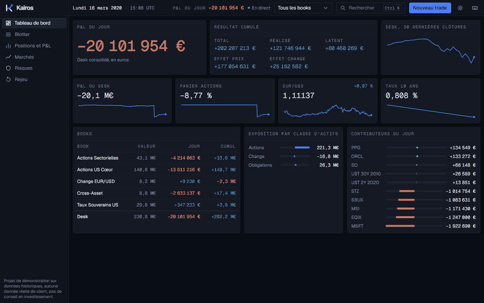
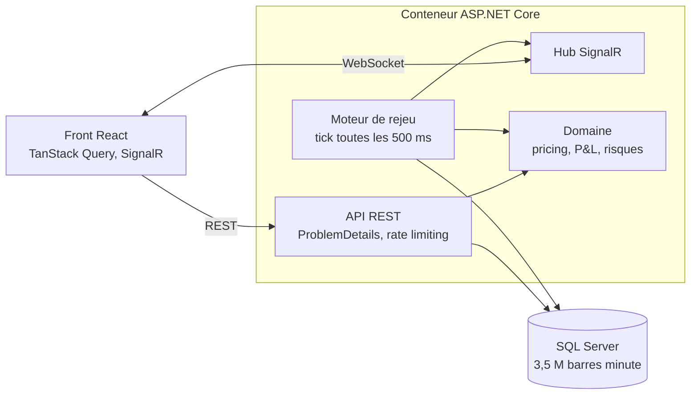

<p align="center">
  <picture>
    <source media="(prefers-color-scheme: dark)" srcset="brand/kairos-mark-dark.svg">
    
  </picture>
</p>

<h1 align="center">Kairos</h1>

<p align="center"><code>CROSS-ASSET TRADING DESK</code></p>

<p align="center">
  Poste de travail de trading cross-asset : actions, change et taux.<br>
  Blotter, positions, P&amp;L consolidé en euros, risques et rejeu de journées de marché historiques.
</p>

<p align="center">
  
</p>

> Projet de démonstration sur données historiques, aucune donnée réelle de client, pas de conseil en investissement. Les traders et les contreparties sont fictifs.

## Ce que fait Kairos

Kairos simule le poste d'un desk de trading basé en zone euro, dans une banque de financement et d'investissement. Le desk compte en euros, mais traite des actifs cotés en dollars : 40 actions américaines, la paire EUR/USD et des obligations du Trésor américain à 2, 5, 10 et 30 ans.

Le serveur rejoue une vraie journée de marché, entre 2010 et 2020, en temps accéléré. Les prix bougent, le portefeuille se revalorise deux fois par seconde, et tous les écrans suivent en direct.

| Écran | Ce qu'on y voit |
|-------|-----------------|
| **Tableau de bord** | P&L du jour et cumulé, décomposé en effet prix et effet change, P&L par book, exposition, principaux contributeurs |
| **Blotter** | Les quelque 3 000 trades du desk, filtrables et exportables en CSV. Ticket de trade, amendement, validation, règlement et annulation, avec historique des versions et piste d'audit |
| **Positions et P&L** | Chaque position au coût moyen pondéré, P&L latent et réalisé, effet prix et effet change par book |
| **Marchés** | Graphiques intrajournaliers et sur un an, courbe des taux comparée à la veille et à l'année précédente |
| **Risques** | Delta actions, delta change, DV01, exposition par classe d'actifs, devise et secteur, stress tests paramétriques et historiques |
| **Rejeu** | Choix de la journée et de la vitesse, et onze journées remarquables (krach de mars 2020, Brexit, flash crash...) |

Toute l'application se pilote au clavier : `Ctrl+K` pour la palette de commandes, `B` et `S` pour acheter ou vendre, `?` pour la liste des raccourcis.

Le vocabulaire métier (book, P&L latent, effet change, date de valeur, DV01...) est expliqué simplement dans [`docs/domaine-metier.md`](docs/domaine-metier.md).

## Architecture



Le backend suit une Clean Architecture en quatre projets : `Domain` (règles métier en C# pur, sans dépendance), `Application` (cas d'usage, validation), `Infrastructure` (EF Core, import des données, rejeu) et `Api`. Le détail, du tick du rejeu à la vie d'un trade, est dans [`docs/architecture.md`](docs/architecture.md).

## Stack

| Partie | Technologies |
|--------|--------------|
| Backend | .NET 10, ASP.NET Core, EF Core 10 et SQL Server, SignalR, FluentValidation, Serilog, Swagger |
| Frontend | React 19, TypeScript, Vite, Tailwind CSS 4, TanStack Query, AG Grid, Lightweight Charts, Motion |
| Tests | xUnit, Testcontainers, WebApplicationFactory, Vitest, Testing Library, Playwright |
| Livraison | Docker multi-étapes, Docker Compose, GitHub Actions, Azure App Service et Azure SQL |

## Lancer Kairos

### 1. Récupérer les données

Les fichiers de marché ne sont pas redistribués dans ce dépôt (voir [Données et licences](#données-et-licences)). Téléchargez les trois jeux de données Kaggle et placez-les ainsi :

```
data/raw/eurusd/eurusd_minute.csv
data/raw/sp500/sp500_stocks.csv
data/raw/sp500/sp500_companies.csv
data/raw/treasury/us_treasury_yields_daily.csv
```

Avec la [CLI Kaggle](https://github.com/Kaggle/kaggle-api) :

```bash
kaggle datasets download andrewmvd/sp-500-stocks -p data/raw/sp500 --unzip
kaggle datasets download imetomi/eur-usd-forex-pair-historical-data-2002-2019 -p data/raw/eurusd --unzip
kaggle datasets download guillemservera/us-treasury-yields-daily -p data/raw/treasury --unzip
```

### 2a. Tout lancer avec Docker

```bash
docker compose up --build
```

Kairos répond sur <http://localhost:8000>, Swagger sur <http://localhost:8000/swagger>. Au premier démarrage, l'API applique les migrations, importe les données (environ 90 secondes) et crée les trades de départ. Les démarrages suivants prennent quelques secondes.

### 2b. Ou lancer en mode développement

Prérequis : .NET SDK 10, Node 24 ou plus, Docker pour SQL Server.

```powershell
docker run -d --name kairos-sql -e ACCEPT_EULA=Y -e "MSSQL_SA_PASSWORD=KairosLocal!2026" -p 127.0.0.1:14333:1433 mcr.microsoft.com/mssql/server:2022-latest

$env:ConnectionStrings__Kairos = "Server=127.0.0.1,14333;Database=Kairos;User Id=sa;Password=KairosLocal!2026;TrustServerCertificate=True"
$env:MarketData__RawPath = "$PWD/data/raw"
dotnet run --project src/Kairos.Api -- --urls http://localhost:5080
```

Dans un second terminal :

```powershell
cd web
npm install
npm run dev
```

L'application répond sur <http://localhost:5173>. Vite redirige `/api` et `/hubs` vers l'API.

### Tests

```bash
dotnet test Kairos.slnx
cd web && npm test
```

Les tests d'infrastructure et d'API démarrent un vrai SQL Server avec Testcontainers : Docker doit tourner. Le contrôle visuel (`npm run visual:review` dans `web/`) capture chaque écran en 1440, 1280 et 390 px, en thème sombre et clair.

| Suite | Tests |
|-------|-------|
| Domaine | 181 |
| Application | 89 |
| Infrastructure | 54 |
| API (intégration) | 40 |
| Front (Vitest) | 200 |

## Déploiement

L'image Docker unique se déploie sur Azure App Service, avec WebSockets activés, et Azure SQL. Le guide pas à pas est dans [`docs/deploiement.md`](docs/deploiement.md).

## Documentation

| Document | Contenu |
|----------|---------|
| [`architecture.md`](docs/architecture.md) | Couches, rejeu, vie d'un trade, données, front, sécurité, tests |
| [`domaine-metier.md`](docs/domaine-metier.md) | Glossaire du trading expliqué simplement, avec des exemples chiffrés |
| [`design-system.md`](docs/design-system.md) | Tokens, typographie, usage du logo, principes d'animation |
| [`donnees.md`](docs/donnees.md) | Sources, formats et contrôles des jeux de données |
| [`decisions.md`](docs/decisions.md) | Les décisions d'architecture (ADR) |
| [`revue-visuelle.md`](docs/revue-visuelle.md) | Contrôle visuel de chaque écran et défauts corrigés |
| [`deploiement.md`](docs/deploiement.md) | Docker Compose et Azure |
| [`questions-entretien.md`](docs/questions-entretien.md) | 25 questions techniques sur le projet, avec leurs réponses |

## Données et licences

La simulation couvre la période du 4 janvier 2010 au 29 avril 2020, soit 2 567 journées de marché. Les fichiers sont téléchargés séparément et ne sont pas redistribués dans ce dépôt. Détails dans [`docs/donnees.md`](docs/donnees.md).

| Données                  | Source Kaggle                                                                                                                                 | Licence déclarée          |
| ------------------------ | --------------------------------------------------------------------------------------------------------------------------------------------- | ------------------------- |
| Actions du S&P 500       | [andrewmvd/sp-500-stocks](https://www.kaggle.com/datasets/andrewmvd/sp-500-stocks)                                                            | CC0 1.0 (domaine public)  |
| EUR/USD minute et heure  | [imetomi/eur-usd-forex-pair-historical-data-2002-2019](https://www.kaggle.com/datasets/imetomi/eur-usd-forex-pair-historical-data-2002-2019)  | GNU AGPL-3.0              |
| Taux du Trésor américain | [guillemservera/us-treasury-yields-daily](https://www.kaggle.com/datasets/guillemservera/us-treasury-yields-daily)                            | CC BY-NC 4.0              |

Les données appartiennent à leurs auteurs respectifs. Ce projet est non commercial. Les graphiques de prix utilisent [TradingView Lightweight Charts](https://www.tradingview.com/lightweight-charts/).
