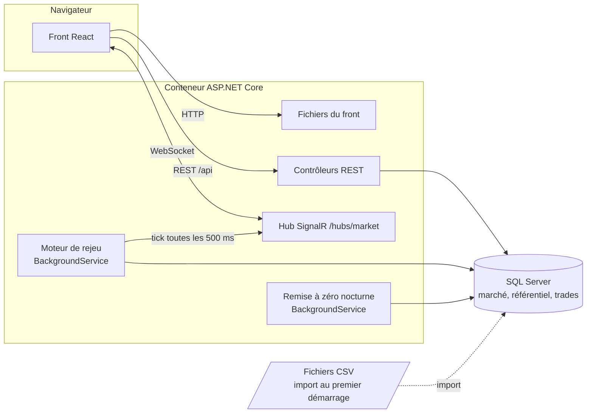
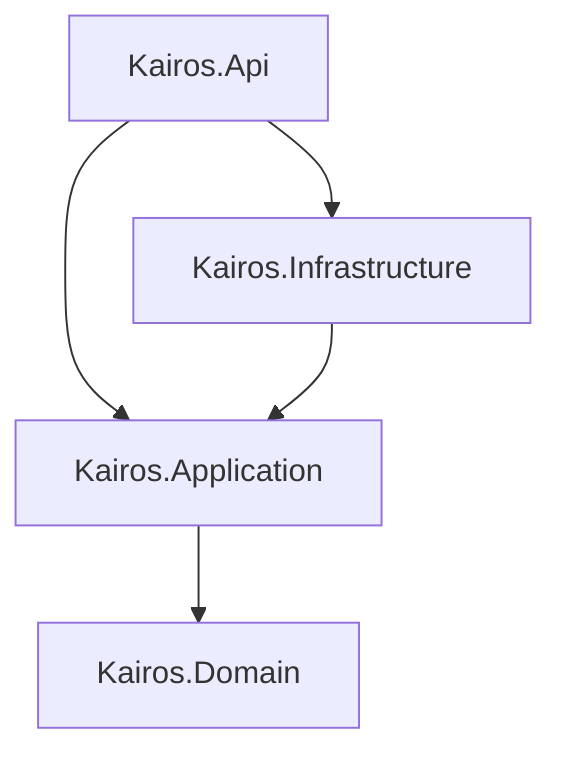

# Architecture

Kairos est une application web en deux parties : une API ASP.NET Core (.NET 10) et un front React (TypeScript, Vite). En production, les deux tournent dans un seul conteneur : l'API sert aussi les fichiers du front (ADR-012).

## Vue d'ensemble



Le serveur rejoue une journée de marché historique en temps accéléré. Toutes les 500 ms, il avance l'horloge, recalcule le marché et la valorisation du portefeuille, puis pousse le résultat aux écrans connectés. Les écrans lisent le reste (trades, historique, scénarios) par REST.

## Backend : quatre projets, une règle de dépendance



Les dépendances vont toujours vers le domaine, jamais dans l'autre sens.

| Projet | Contenu | Dépend de |
|--------|---------|-----------|
| `Kairos.Domain` | Les règles métier en C# pur : `Money`, positions au coût moyen pondéré, pricing obligataire, courbe des taux, machine à états des trades, dates de valeur, risques et stress tests. Aucun accès à la base, au réseau ou à l'horloge. | rien |
| `Kairos.Application` | Les cas d'usage (réserver un trade, valoriser le portefeuille, calculer les risques, piloter le rejeu), les DTO échangés avec le front, la validation FluentValidation et les interfaces que l'infrastructure implémente. | Domain |
| `Kairos.Infrastructure` | EF Core et SQL Server, l'import des fichiers CSV, le seed du référentiel et des 2 992 trades de départ, le moteur de rejeu et la remise à zéro nocturne. | Application |
| `Kairos.Api` | Les contrôleurs REST, le hub SignalR, la gestion des erreurs en ProblemDetails, la sécurité (limitation de débit, CORS, en-têtes), les health checks et le service des fichiers du front. | Application, Infrastructure |

L'application déclare ce dont elle a besoin sous forme d'interfaces (`Kairos.Application/Abstractions/Ports.cs`) :

| Interface | Rôle | Implémentation |
|-----------|------|----------------|
| `ITradeRepository` | Lire et enregistrer les trades | `TradeRepository` (EF Core) |
| `IMarketHistory` | Barres journalières, courbes, minutes EUR/USD | `MarketHistoryRepository` (EF Core) |
| `IReferenceDataProvider` | Instruments, books, traders, contreparties | `ReferenceDataProvider` (cache mémoire) |
| `IMarketState` | Le marché courant du rejeu | `LiveMarketState` |
| `ITradeNotifier`, `IMarketBroadcaster` | Prévenir les écrans | `SignalRTradeNotifier`, `SignalRBroadcaster` |
| `ICurrentActor` | Qui agit, pour la piste d'audit | `DemoActor` (démo sans connexion) |

Le domaine se teste donc sans base ni serveur, et les cas d'usage avec des doublures en mémoire.

## Le rejeu, tick par tick

Le moteur (`Kairos.Infrastructure/Replay/ReplayEngine.cs`) est un `BackgroundService`. À chaque tick :

1. `ReplayClock` avance le temps simulé selon la vitesse choisie (de 30 à 1 800 secondes simulées par seconde réelle). À la fin de la journée, il recommence au début pour que la démo ne s'arrête jamais.
2. `ReplayDay.MarketAt(minute)` reconstruit le `MarketSnapshot` de la minute :
   - **EUR/USD** : la vraie cotation bid/ask de la minute, issue du fichier minute.
   - **Actions** : un chemin minute par minute généré à partir de l'ouverture, du plus haut, du plus bas et de la clôture du jour (`IntradayPathGenerator`, un pont brownien déterministe qui passe exactement par ces quatre points).
   - **Taux** : la courbe glisse de la clôture de la veille vers celle du jour au fil de la journée.
3. `PortfolioValuator` valorise les positions en mémoire dans ce marché. Les positions ne sont recalculées que si un trade change ou si la date change : seule leur valorisation bouge à chaque tick.
4. `MarketTickBuilder` assemble le message : horloge, cotations, courbe, P&L par book.
5. `SignalRBroadcaster` l'envoie à tous les écrans (`tick`). Les positions détaillées et le rapport de risque, plus lourds, ne partent qu'aux écrans qui les affichent (groupes SignalR `positions` et `risk`).

Le rejeu est partagé par tous les visiteurs, comme un marché commun (ADR-011). Après 20 minutes sans commande, il revient seul à la journée par défaut.

## La vie d'un trade

1. Le ticket propose le prix du marché (ask à l'achat, bid à la vente), puis envoie `POST /api/trades`. FluentValidation vérifie la requête : un problème renvoie une 400 en ProblemDetails, avec les erreurs par champ.
2. `TradeService` vérifie que l'instrument est négociable à la date du trade, calcule la date de valeur, fixe le taux EUR/USD du jour qui servira au coût en euros, puis crée le trade avec sa première version et sa piste d'audit.
3. Le dépôt l'enregistre. Un trade, ses versions et son audit sont chargés et enregistrés ensemble (tables `Trades`, `TradeVersions`, `TradeAuditEntries`).
4. Le notifieur pousse `tradeChanged` : le blotter met à jour une seule ligne sans tout recharger, et les positions sont recalculées.

Ensuite, le trade suit la machine à états du domaine (`TradeStateMachine`) : validation, amendement (qui crée une nouvelle version et repasse le trade en `New`), règlement ou annulation.

## Données

| Table | Contenu | Volume |
|-------|---------|--------|
| `EurUsdMinuteBars` | Bid et ask EUR/USD de chaque minute | environ 3,5 millions de lignes |
| `EurUsdDailyBars`, `EquityDailyBars` | Barres journalières | 2 567 jours, 40 actions |
| `CurvePoints` | Courbe du Trésor américain, de 1 mois à 30 ans | 2 567 courbes |
| `Instruments`, `Books`, `Traders`, `Counterparties` | Référentiel, avec des identifiants déterministes | 53 instruments, 5 books |
| `Trades`, `TradeVersions`, `TradeAuditEntries` | Le blotter, l'historique des versions et la piste d'audit | 2 992 trades au départ |

Au démarrage, `DatabaseInitializer` applique les migrations EF Core, importe les fichiers s'ils manquent en base (avec `SqlBulkCopy`), crée le référentiel et les trades de départ. Chaque nuit à 3 h UTC, `NightlyResetService` remet les trades dans leur état de départ. Les données de marché ne sont jamais touchées.

## Frontend

```
web/src/
  api/            client REST, types, requêtes TanStack Query
  realtime/       connexion SignalR et magasin des données en direct
  design-system/  tokens, mouvements, composants, logo, grille AG Grid
  app/            coquille de l'application : barre latérale, barre haute, palette Ctrl+K, raccourcis
  features/       une page par dossier, chacune avec son modèle testé à part
  lib/            formatage des nombres et des dates, libellés
```

- **Deux sources de données, deux outils.** TanStack Query gère ce qui se lit par REST : cache, rechargement et invalidation quand la date de marché change. Les données poussées par SignalR passent par un magasin unique (`LiveStore`), lu avec `useSyncExternalStore`, si bien qu'un tick ne redessine que les composants qui lisent ce qui a changé.
- **Abonnements à la demande.** Une page déclare les sujets lourds qu'elle affiche (`positions`, `risk`) : le serveur ne les envoie que tant qu'elle est ouverte.
- **Modèles séparés de l'affichage.** Chaque page a un fichier `*Model.ts` de fonctions pures (tri, regroupements, calculs d'affichage) testé avec Vitest, et un composant qui ne fait qu'afficher.
- **Chargement à la demande.** La landing page est publique et légère. L'application de travail, avec AG Grid et les graphiques, n'est chargée qu'à l'ouverture de `/app`.

## Sécurité d'une démo publique

- Pas de compte : toutes les actions sont enregistrées sous le même nom.
- Limitation de débit par adresse : 600 lectures et 60 écritures par minute, avec une réponse 429 en ProblemDetails et un en-tête `Retry-After`. Les health checks ne sont pas limités.
- Derrière un proxy, l'adresse du client est lue dans `X-Forwarded-For`, en ne gardant que la dernière entrée, celle écrite par notre propre proxy.
- CORS fermé par défaut, ouvert seulement aux origines listées dans la configuration.
- En-têtes `X-Content-Type-Options`, `X-Frame-Options` et `Referrer-Policy` sur chaque réponse.
- Remise à zéro des trades chaque nuit.

## Observabilité

- Journaux structurés Serilog, une ligne par requête HTTP.
- `/health` répond tant que le processus tourne. `/health/ready` vérifie aussi la base : c'est celui qu'utilise App Service.
- Swagger sur `/swagger`.

## Tests

| Projet | Ce qui est testé | Comment |
|--------|------------------|---------|
| `Kairos.Domain.Tests` | Pricing obligataire, conversion de devises, P&L et effet change, machine à états, dates de valeur, stress tests | xUnit, sans dépendance |
| `Kairos.Application.Tests` | Cas d'usage, validation, valorisation, construction des ticks | xUnit, doublures en mémoire |
| `Kairos.Infrastructure.Tests` | Import CSV, seed, dépôts, rejeu | xUnit et Testcontainers (vrai SQL Server) |
| `Kairos.Api.IntegrationTests` | Routes, erreurs, temps réel, sécurité, service du front | `WebApplicationFactory` et Testcontainers |
| `web` (Vitest) | Formatage, modèles des pages, composants | Vitest et Testing Library |

La CI GitHub Actions lance l'ensemble à chaque push, puis vérifie que l'image Docker se construit.
