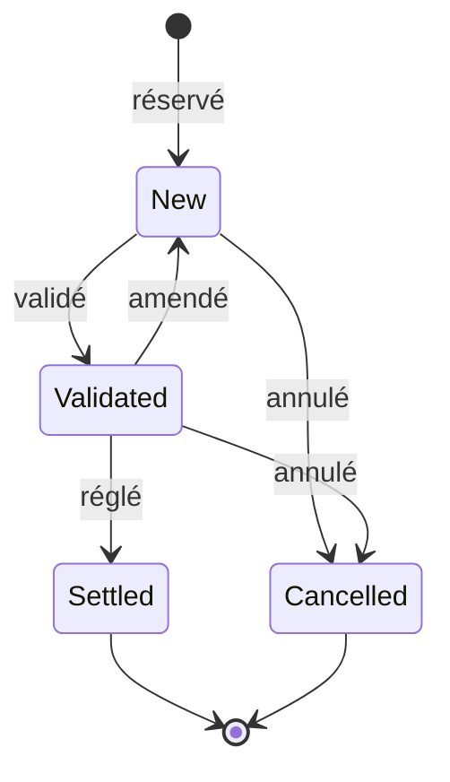

# Domaine métier

Kairos reproduit le poste de travail d'un desk de trading cross-asset dans une banque de financement et d'investissement. Le desk est basé en zone euro, compte en euros, et traite trois classes d'actifs cotées en dollars :

| Classe d'actifs | Instruments dans Kairos | Prix affiché |
|-----------------|-------------------------|--------------|
| Actions | 40 actions américaines du S&P 500, 11 secteurs | en dollars par action |
| Change | EUR/USD | en dollars pour un euro |
| Taux | Obligations du Trésor américain à 2, 5, 10 et 30 ans | en pourcentage du nominal (prix pour 100) |

Le code métier se trouve dans `src/Kairos.Domain`. Chaque définition ci-dessous renvoie au fichier qui l'applique.

## Glossaire

### Blotter

Le registre de tous les trades du desk : qui a traité quoi, dans quel sens, en quelle quantité, à quel prix, avec quelle contrepartie et dans quel book. C'est l'écran que le trader et le middle office regardent en premier.

Dans Kairos, chaque trade garde l'historique de ses versions et une piste d'audit : qui l'a créé, amendé, validé, réglé ou annulé, et quand (`Trades/Trade.cs`).

### Cycle de vie d'un trade

- **New** : le trade est saisi, il compte déjà dans les positions.
- **Validated** : le middle office a contrôlé les conditions.
- **Settled** : les titres et l'argent ont été échangés à la date de valeur. Plus rien ne peut changer.
- **Cancelled** : le trade est annulé et ne compte plus dans les positions.

Amender un trade validé crée une nouvelle version et le renvoie en `New` : une modification doit être revalidée. Toutes les transitions sont décrites à un seul endroit (`Trades/TradeStateMachine.cs`).

### Book

Un portefeuille de gestion : un regroupement de trades suivi par une équipe ou une stratégie. Le P&L et les risques se lisent par book, puis pour le desk entier. Kairos en compte cinq : Actions US Cœur, Actions Sectorielles, Change EUR/USD, Taux Souverains US et Cross-Asset.

### Position

Ce que le desk détient sur un instrument dans un book, une fois tous ses trades additionnés. Une position est **longue** (quantité positive) quand on a acheté plus que vendu, **courte** (quantité négative) dans le cas contraire.

Kairos suit chaque position au **coût moyen pondéré** : un achat qui augmente la position fait la moyenne entre l'ancien prix et le nouveau, une vente qui la réduit dégage un P&L réalisé sans changer le prix moyen de ce qui reste (`Positions/Position.cs`).

### Bid, ask et spread

- Le **bid** est le prix auquel le marché achète : c'est le prix qu'obtient un vendeur.
- L'**ask** (ou offre) est le prix auquel le marché vend : c'est le prix que paie un acheteur.
- Le **spread** est l'écart entre les deux, la rémunération de celui qui fait le marché.

Le ticket de Kairos propose donc l'ask pour un achat et le bid pour une vente. Pour valoriser une position EUR/USD, il prend le prix auquel on pourrait la fermer maintenant : le bid pour une position longue, l'ask pour une courte (`Fx/EurUsdQuote.cs`). Seul EUR/USD a un vrai bid et ask dans les données. Les actions et les obligations reçoivent un écart d'un tick autour du dernier prix.

### P&L réalisé et P&L latent

Le P&L (profit and loss) est le gain ou la perte.

- Le **P&L réalisé** est acquis : il naît quand on ferme tout ou partie d'une position. Acheter 100 actions à 45 $ et en revendre 100 à 54 $ réalise 900 $ de gain.
- Le **P&L latent** (ou non réalisé) est celui d'une position encore ouverte, évalué au prix du marché. Il bouge à chaque tick et peut disparaître si le marché se retourne.

Le **P&L total** est la somme des deux. Le **P&L du jour** est la variation du P&L total depuis la clôture de la veille.

### Effet change

Le desk compte en euros mais achète des actifs en dollars. Son P&L en euros bouge donc pour deux raisons : le prix de l'actif, et le taux EUR/USD. Kairos sépare les deux (ADR-008) :

- l'**effet prix** est le mouvement du prix de l'actif, converti au taux du jour ;
- l'**effet change** est le mouvement du taux EUR/USD appliqué au capital investi.

Exemple, celui de la page d'accueil :

| Étape | Calcul | Montant |
|-------|--------|---------|
| Achat de 100 actions à 45,00 $, 1 € = 1,125 $ | 100 × 45 ÷ 1,125 | 4 000,00 € investis |
| Cours actuel 54,00 $, 1 € = 1,200 $ | 100 × 54 ÷ 1,20 | 4 500,00 € de valeur |
| Effet prix | 100 × (54 − 45) ÷ 1,20 | +750,00 € |
| Effet change | 100 × 45 ÷ 1,20 − 4 000 | −250,00 € |
| P&L en euros | | +500,00 € |

L'action a gagné 20 %, mais le dollar a perdu de la valeur face à l'euro : les 4 500 $ investis, payés 4 000 €, ne valent plus que 3 750 €. Les deux effets s'additionnent exactement au P&L, sans résidu inexpliqué.

Une position EUR/USD n'a pas d'effet change sur capital : elle est financée en dollars et n'investit pas d'euros. Tout son P&L est un effet prix.

### Date de valeur

La date à laquelle un trade est réellement réglé, c'est-à-dire où les titres et l'argent changent de main. Elle suit la date de négociation de quelques jours ouvrés :

| Classe d'actifs | Convention | Exemple : trade le vendredi 13 mars 2020 |
|-----------------|------------|------------------------------------------|
| Actions | T+2 | mardi 17 mars |
| Change au comptant | T+2 | mardi 17 mars |
| Obligations du Trésor | T+1 | lundi 16 mars |

Les week-ends sont sautés. Les jours fériés ne sont pas gérés, ce qui est une simplification assumée (`Trades/ValueDateCalculator.cs`).

### Courbe des taux

Le rendement exigé par les investisseurs pour prêter à l'État américain, selon la durée du prêt : de 1 mois à 30 ans. Une courbe normale monte avec la durée. Quand les taux courts dépassent les taux longs, la courbe est **inversée**, ce qui annonce souvent une récession.

La **pente 2-10 ans** (taux à 10 ans moins taux à 2 ans, en points de base) résume sa forme. Entre deux maturités publiées, Kairos interpole linéairement (`Rates/YieldCurve.cs`). Pendant le rejeu, la courbe glisse de celle de la veille vers celle du jour au fil des minutes.

Un **point de base** (pb) vaut 0,01 %.

### Prix d'une obligation

Une obligation verse un coupon fixe tous les six mois, puis rembourse son nominal à l'échéance. Son prix est la somme de ces flux, actualisés au taux de la courbe pour sa durée restante : quand les taux montent, le prix baisse.

- Le **coupon couru** est la part du prochain coupon déjà gagnée depuis le dernier versement.
- Le **prix clean** est le prix coté, sans coupon couru.
- Le **prix dirty** est le prix réellement payé : clean plus coupon couru.

Kairos applique les conventions du Trésor américain : capitalisation semestrielle et décompte des jours réels (`Rates/BondPricer.cs`). Une obligation échue vaut son nominal, soit 100. Comme une obligation à 2 ans ne peut pas vivre dix ans, chaque maturité est réémise à l'échéance de la précédente (ADR-010).

### Duration

La sensibilité du prix d'une obligation aux taux. Une **duration modifiée** de 8 signifie que le prix baisse d'environ 8 % si les taux montent de 1 %. Plus l'échéance est lointaine, plus la duration est forte : une obligation à 30 ans réagit bien plus qu'une à 2 ans.

### DV01

Le gain ou la perte pour un mouvement des taux d'un point de base (dollar value of one basis point). C'est la duration exprimée en argent : DV01 = duration modifiée × prix dirty × 0,0001, pour 100 de nominal.

Dans Kairos, le DV01 du desk est la somme des DV01 de toutes les positions obligataires, convertie en euros. Il est positif pour une position longue : c'est ce qu'elle perd si les taux montent d'un point de base (`Risk/RiskCalculator.cs`).

### Exposition et sensibilités

- L'**exposition** est la valeur de marché détenue, en euros, ventilée par classe d'actifs, par devise et par secteur.
- Le **delta actions** est le P&L si toutes les actions montent de 1 %.
- Le **delta change** est le P&L si EUR/USD monte de 1 %.

Kairos calcule les deux deltas en revalorisant réellement le portefeuille après le choc, plutôt qu'avec une formule approchée.

### Stress test

La question « combien perdrait le desk si le marché faisait ceci ? ». Kairos en propose deux sortes (`Risk/StressScenario.cs`, `Risk/StressEngine.cs`) :

- **paramétrique** : un choc choisi, appliqué partout, par exemple actions −20 %, EUR/USD +5 %, taux +100 pb ;
- **historique** : les mouvements réellement observés entre deux dates, action par action et maturité par maturité. Kairos en propose six, du taper tantrum de 2013 au krach de mars 2020 (du 19 février au 23 mars).

Dans les deux cas, chaque position est revalorisée dans le marché choqué (ADR-009). La convexité des obligations et le cumul des chocs actions et change sont donc pris en compte, ce qu'un calcul par sensibilités ignorerait.

### Séance de marché

Les actions américaines se traitent de 9 h 30 à 16 h, heure de New York. Kairos travaille en UTC, donc l'ouverture tombe à 14 h 30 UTC l'hiver et à 13 h 30 UTC l'été (`Market/UsEquitySession.cs`). Avant l'ouverture, les actions restent à leur clôture de la veille, alors qu'EUR/USD cote toute la journée.

## Ce que Kairos simplifie

| Simplification | Pourquoi c'est acceptable ici |
|----------------|-------------------------------|
| Pas de jours fériés dans les dates de valeur | Seuls les week-ends influencent la démonstration |
| Coupons encaissés et portage hors du P&L, obligations suivies au prix clean | Le but est de montrer l'effet prix, l'effet change et la sensibilité aux taux |
| Prix intrajournaliers des actions reconstruits à partir de l'ouverture, du plus haut, du plus bas et de la clôture | Les données gratuites ne contiennent que des barres journalières |
| Portefeuille non couvert contre le change | Rend l'effet change visible, ce qui est l'intérêt de l'exercice |
| Exécution immédiate au prix affiché, sans carnet d'ordres | Kairos est un poste de suivi, pas un système de passage d'ordres |
